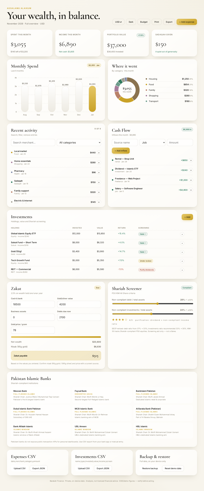
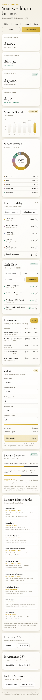
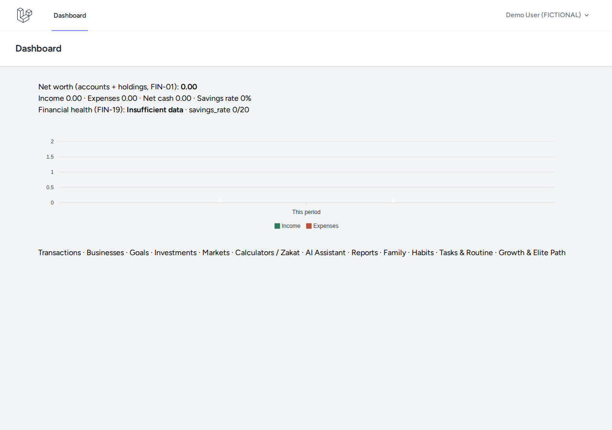
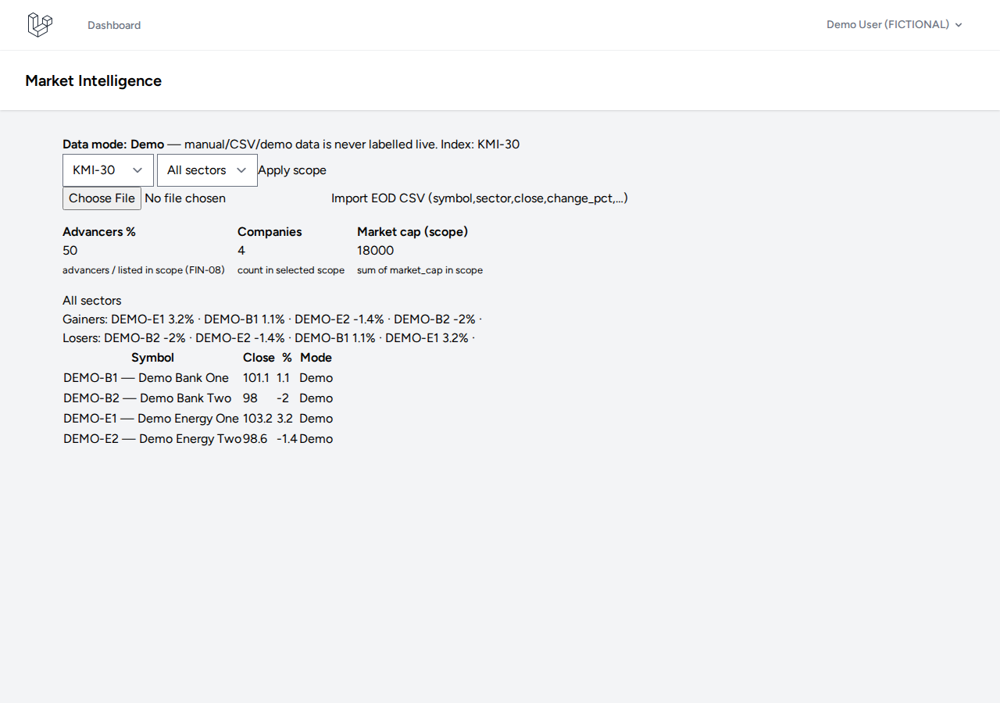

# Financial Management System

Personal Islamic finance dashboard, currently implemented through **v1.0**.

## Repository organisation

All documents live in **[docs/](docs/)** — see the full map in **[docs/PROJECT-TREE.md](docs/PROJECT-TREE.md)**. The live app is in `apps/static-v1/`; reusable agent skills are in `skills/`.

## Platform planning (Arena build contract)

The full technical plan for evolving Financial Management System into the Complete Financial Intelligence Platform is in **[docs/01-architecture/TECHNICAL-PLAN.md](docs/01-architecture/TECHNICAL-PLAN.md)**, with binding companions: [PROJECT](docs/00-project/PROJECT.md) · [PRD](docs/00-project/PRD.md) · [ARCHITECTURE](docs/01-architecture/ARCHITECTURE.md) · [DATABASE](docs/01-architecture/DATABASE.md) · [FINANCIAL-RULES](docs/02-finance/FINANCIAL-RULES.md) · [ISLAMIC-FINANCE](docs/02-finance/ISLAMIC-FINANCE.md) · [DATA-SOURCES](docs/02-finance/DATA-SOURCES.md) · [SOUL](docs/03-governance/SOUL.md) · [AGENTS](docs/03-governance/AGENTS.md) · [ROADMAP](docs/03-governance/ROADMAP.md) · [DECISIONS](docs/03-governance/DECISIONS.md) · [SECURITY](docs/03-governance/SECURITY.md) · [TESTING](docs/03-governance/TESTING.md) · [skills/](skills/) · [UI-DESIGN](docs/01-architecture/UI-DESIGN.md) · [STACK-AUDIT](docs/01-architecture/STACK-AUDIT.md) · [CONTRIBUTING](docs/03-governance/CONTRIBUTING.md)

Build order is **[docs/03-governance/ROADMAP.md](docs/03-governance/ROADMAP.md)** — one phase at a time, owner-tested. Current status: **static roadmap complete (v1.0–v2.0) + Laravel platform Phases 2–15 + Life OS (Family/Habits/Tasks/Growth/Elite Path) built and CI-verified** — investments, cash flow, zakat, Shariah screener, Islamic banks, CSV import/export, backup/restore, search/filter/delete, budget edit, PKR/USD display toggle, dark mode, print view, PWA manifest. Platform stack is now **Laravel 13 + PostgreSQL** (D-012, STACK-AUDIT); build follows the 16-phase prompts in ROADMAP (Phases 0–1 done). PHP runs via GitHub Actions/owner machine — no PHP in the Arena sandbox (D-014).

## v1.1 test checklist (Phase 1)

- [ ] "Monthly Spend" bar chart (last 6 months) renders below the stat cards; Jan bar is gold, earlier bars soft white; totals shown (Jan $3,055)
- [ ] "Where it went" donut centre = your current expense total; legend lists top 5 categories with amounts + %
- [ ] Add an expense → donut + legend + centre total update immediately (bar chart is the fixed 6-month trend per spec)
- [ ] Charts stack to one column on mobile; no console errors

## Screenshots

Real screenshots captured in CI (Playwright, seeded FICTIONAL demo data) — refresh them after any UI change via the **Screenshots (docs)** workflow; PRs with UI changes must include updated screenshots (see `.github/pull_request_template.md`).

| Static live demo (desktop) | Static live demo (mobile) |
|---|---|
|  |  |

| Laravel platform — Dashboard | Laravel platform — Market Intelligence |
|---|---|
|  |  |

More: [login](docs/screenshots/platform-login.png) · [accounts](docs/screenshots/platform-accounts.png) · [calculators/zakat](docs/screenshots/platform-calculators.png) · [habits](docs/screenshots/platform-habits.png)

## Platform (Laravel) — run locally

Requires PHP 8.3+ and Composer (or use the Docker image in `apps/platform/Dockerfile` / GitHub Actions CI, which verifies every change on PostgreSQL 16):

```bash
cd apps/platform
composer install && npm ci && npm run build
cp .env.example .env && php artisan key:generate
php artisan migrate --seed
php artisan serve
```

Demo login (FICTIONAL seeded data): `demo@financial.local` / `password`

## Why do I see the word "Illuminate"?

`Illuminate` is not a separate product added to this project — it is Laravel framework's own internal package namespace, so it appears inside Laravel's vendor code and standard framework imports. It is never shown to end users in the UI. The Laravel stack was chosen from the owner's approved master prompt (Laravel + PostgreSQL + Blade). Removing the word entirely would mean replacing the Laravel framework itself; that decision and its alternatives are recorded in `docs/01-architecture/STACK-AUDIT.md` and `docs/03-governance/DECISIONS.md` (D-012/D-017).

## View it on GitHub Pages

**Live URL (once Pages is enabled):** <https://bc260212477.github.io/Islamic-Financial-Management-System-/>

The repo is public and the automation token has admin on the repo, but only
`pages=read` on the Pages API — so GitHub will not let automation *create*
the Pages site (`Resource not accessible by integration`). The owner must
flip one setting, once:

1. Open <https://github.com/bc260212477/Islamic-Financial-Management-System-/settings/pages>
2. Under **Build and deployment → Source**, choose **GitHub Actions**.
3. Then run/approve the **Deploy** workflow (Actions tab), or
   push to `main` — the workflow at `.github/workflows/deploy-pages.yml` deploys it.

Future pushes to `main` will redeploy the site automatically.

## Local preview

From the repository root, run:

```bash
python3 -m http.server 4173 --directory apps/static-v1
```

Then open <http://127.0.0.1:4173/>.

## v1.0 test checklist (test before approving v1.1)

- [ ] Header shows "Assalamu alaikum", "Your wealth, in balance.", month · Full overview, Export + "+ Add expense"
- [ ] Spent this month = **$3,055** ("$145 left of $3,200"), Sadaqah given = **$150** (green); Income/Portfolio show $0 until v1.3/v1.2
- [ ] Recent activity lists the 9 seed expenses, newest first, with category dots
- [ ] "+ Add expense" → add one → it appears in Recent activity and Spent/Sadaqah totals update
- [ ] Refresh the page — the added expense is still there (localStorage)
- [ ] Add expenses past $3,200 total — the note turns red and reads "$X over $3,200"
- [ ] Placeholder cards are shown for v1.1–v1.6 features (not yet built, per `docs/00-project/BARAKAH-PROJECT.md`)
- [ ] No console errors; layout works down to 375px wide

**Do not start v1.1 until this checklist passes.** Report any defects as a clear list.
## 🌐 Web SaaS (apps/web) — the clickable product
Full Financial Management System in the browser: login/demo workspace, Dashboard, Accounts, Transactions, Budgets, Goals, Cash Flow, Businesses, Holdings, PSX screener (DEMO-labelled), **Tools Hub** (Zakat, Halal Screener, Purification, Riba Detector, Debt Payoff, Goal Planner, Inflation, PK Tax, Subscription Audit), Islamic Finance, Family, Habits, Tasks, Growth, Health, Legacy, AI Decision OS, Reports, Plans/Settings. Demo login: `demo@financial.local` / `password` (FICTIONAL data, browser-local). Run: `python3 -m http.server 8080 --directory apps/web`. Details: docs/00-project/WEB-SAAS.md. Production backend remains the Laravel platform below.

